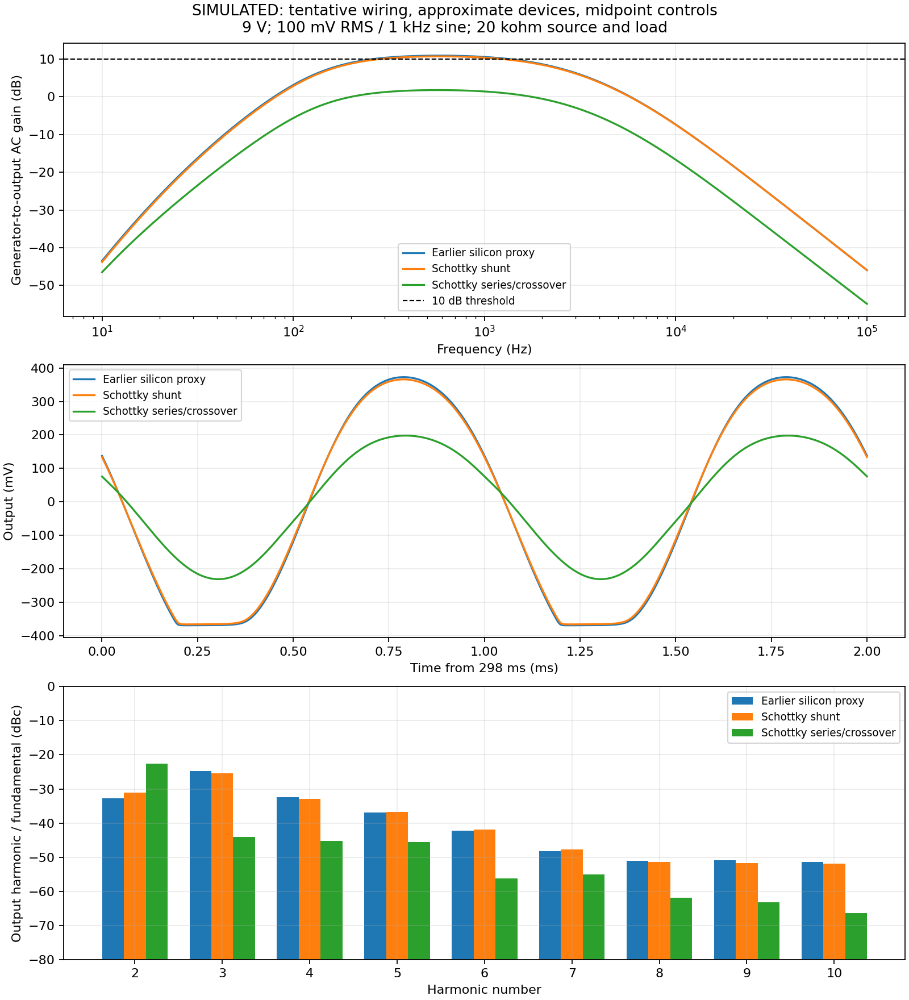

# Image-v2: Schottky shunt versus series crossover

**All values below are simulations, not bench measurements.** User confirmed
Q1–Q3 are S8050, diodes are Schottky, and the switch selects shunt clipping or
series crossover distortion. [Wiring and model notes](../../schematics/image-v2/TRANSCRIPTION.md)
describe the corrected transcription and remaining assumptions. Image-v1 is
retained as historical evidence, not the current device/switch interpretation.

## Expected effect and actual model changes

The diode approximation changes from silicon to Schottky, so conduction is
expected at lower voltage. Switching the antiparallel pair from a ground shunt
to a series signal element is expected to reduce conduction near zero crossings
and change gain and harmonics. This is the same antiparallel pair in either mode,
not two diodes in anti-series. Whole-circuit THD need not increase monotonically
with lower diode voltage because the other nonlinear stages also contribute.

Q1–Q3 are now assigned `S8050_APPROX`; its parameters remain the earlier generic
NPN proxy, **not a manufacturer S8050 model**. The diode approximation uses
IS=200 nA, N=1.05, RS=2 ohm, CJO=10 pF and BV=30 V. Exact diode part and S8050
manufacturer/model remain unspecified. Results cannot establish real part accuracy.
These are transcription corrections, not proposed circuit improvements.

## Same test conditions in both switch modes

9 V supply; 100 mA stated current budget; pictured 100 ohm supply filter;
100 mV RMS unloaded 1 kHz generator, zero DC offset, 20 kohm source resistance,
20 kohm output load, 27 C. Assumed drive and tone rheostats are each 50 kohm;
volume is a 50% resistance split. The 5 kohm shunt and drive-pot wiring still
need confirmation. No controls have been optimized to meet the target.

| Simulated metric | Earlier silicon proxy | Schottky shunt | Schottky series/crossover |
| --- | ---: | ---: | ---: |
| Quiescent supply current (mA) | 1.3482 | 1.3484 | 1.3484 |
| Small signal gain, generator reference, 1 kHz (dB) | 10.542 | 10.348 | 1.395 |
| Small signal gain, loaded pedal-input reference (dB) | 18.642 | 18.402 | 9.555 |
| Large signal fundamental gain, generator reference (dB) | 8.983 | 8.840 | 3.608 |
| Large signal fundamental gain, loaded input reference (dB) | 16.404 | 16.216 | 11.143 |
| Output fundamental (mV RMS) | 281.272 | 276.689 | 151.498 |
| Output THD10 (%) | 6.902 | 6.723 | 7.486 |
| Output H2 (dBc) | -32.716 | -31.141 | -22.596 |
| Output H3 (dBc) | -24.738 | -25.351 | -44.045 |

At 100 mV RMS and the assumed controls, **both switch modes fall below >10 dB
when gain is referenced to the generator's fundamental**. Small signal gain is
above 10 dB only in shunt mode on that reference. Both modes exceed 10 dB large
signal gain relative to the loaded pedal-input fundamental. These are conditional
comparisons; the final gain definition and control settings are still pending.
THD has no specified limit and is descriptive only. Small signal AC linearizes
around the zero-signal operating point; it cannot substitute for nonlinear gain
or harmonic measurements in crossover mode.

The series-mode spectrum is dominated by H2 under these conditions. Its final
output waveform is smoother than an ideal unfiltered crossover notch; the
approximate Schottky leakage, surrounding gain stages and filtering matter.
This does not establish that the physical circuit will exhibit the same spectrum.



## Execution and numerical checks

Both modes completed operating point (1 solution), AC (401 frequency points,
10 Hz–100 kHz), and transient (20,001 saved points, about 280–300 ms). Logs report
no analysis/convergence errors. The library's missing `spinit` warning remains;
the decks use explicit local models and native ngspice syntax.

Harmonic measurements use the same 290–300 ms window as image-v1, linear
resampling at 1 us, coherent rectangular-window Fourier extraction, H1–H10.
THD10 excludes noise and harmonics above H10. Adjacent 5 ms windows differ by
about 1.06 uV fundamental RMS in shunt mode and 0.000145 uV in crossover mode.

Halving maximum transient step from 1 us to 0.5 us gave:

| Numerical check | 1 us | 0.5 us |
| --- | ---: | ---: |
| Shunt fundamental (V RMS) | 0.276688909 | 0.276689854 |
| Shunt THD10 (%) | 6.722839 | 6.723088 |
| Crossover fundamental (V RMS) | 0.151498188 | 0.151498705 |
| Crossover THD10 (%) | 7.486015 | 7.486123 |

The numerical changes are small. This checks timestep sensitivity, not device
model accuracy or uncertain wiring. Runs retain raw data, CSVs, logs, copied
netlists/models, hashes and measurements JSON in `image-v2-shunt`,
`image-v2-crossover`, and their `-refined` directories alongside this report.

## Repeat

From `/workspace/Pedal-Design-Iterator`, use new output directories:

```sh
python3 simulation/run_shared.py --benches simulation/benches/image-v2-shunt --output simulation/results/shunt-next
python3 simulation/analyze_image.py simulation/results/shunt-next
python3 simulation/run_shared.py --benches simulation/benches/image-v2-crossover --output simulation/results/crossover-next
python3 simulation/analyze_image.py simulation/results/crossover-next
```

`run_shared.py` defaults to the v2 shunt deck. Both modes must be rerun after any
future schematic change. `compare_image_modes.py` regenerates the present plot
from the retained original run directory names and requires matplotlib.

Remaining work: confirm pot/5 kohm wiring; select actual manufacturer models;
create/reconcile the KiCad design record; define control positions and the gain
reference/regime. Hardware bias, pickup interaction, noise, tolerances, stability
and subjective sound still require bench testing. No compressor measurements
have been established.
